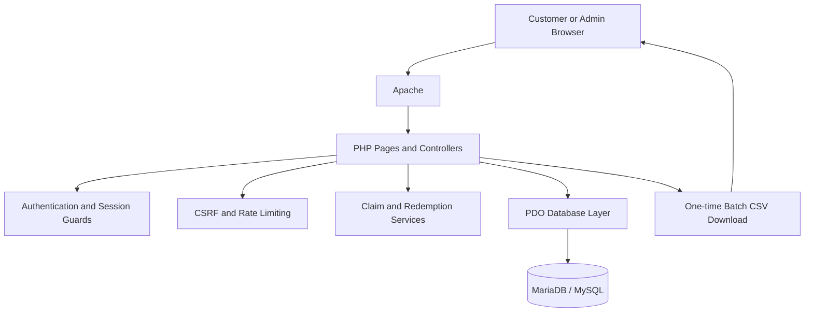
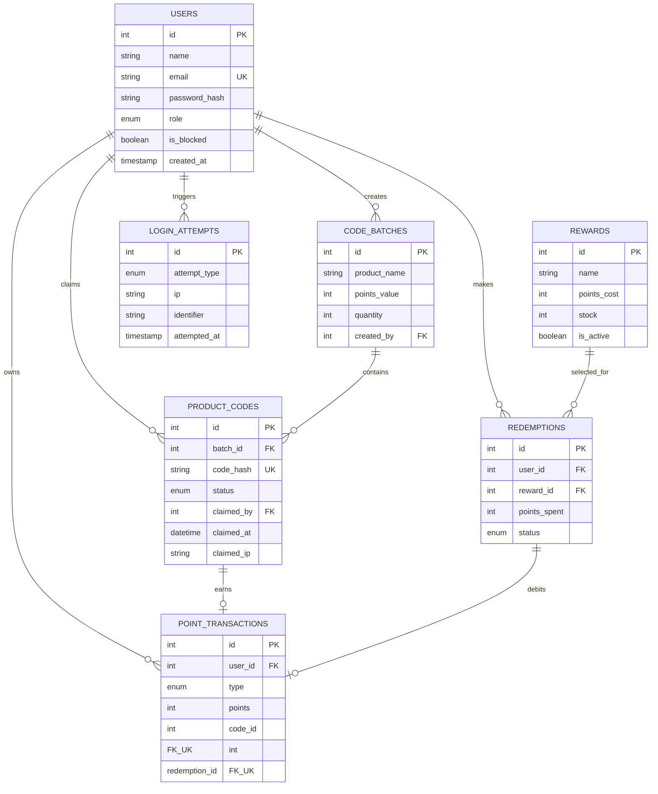

# LoyalBox – Architecture

## 1. Overview

LoyalBox is a server-rendered PHP web application. A browser submits standard HTTP forms to PHP pages. PHP authenticates the session, validates input and CSRF tokens, calls the PDO database layer, and renders HTML with Bootstrap classes. MariaDB/MySQL stores accounts, code batches, hashed product codes, rewards, redemptions, login attempts, and the points ledger.

The current project is designed and tested for a local XAMPP installation.

## 2. Technology choices

| Layer | Technology | Reason |
|---|---|---|
| Web server / runtime | Apache + PHP 8 | Simple server-rendered implementation suited to the XAMPP environment |
| Database | MariaDB / MySQL, InnoDB | Relational constraints and transactions support one-time claims and safe redemptions |
| Database access | PDO prepared statements | Parameterized database access and exception-based error handling |
| UI | HTML, Bootstrap 5.3.3 CDN | Responsive layout without introducing a frontend build pipeline |
| Browser behavior | Vanilla JavaScript | Small interactions such as confirmation prompts are sufficient |
| Configuration | .env file parsed by includes/config.php | Local credentials stay out of version control |
| Version control | Git and GitHub | Commit history and public source repository |

## 3. Component diagram

The PHP page/controller layer includes public pages such as registration and login, customer pages, and admin pages. Shared functions are in the includes directory. The CSV output is generated by the admin batch page after the database transaction commits.

## 4. Main application modules

| Module | Main files | Responsibility |
|---|---|---|
| Configuration and database | includes/config.php, includes/db.php | Read local .env settings and create the PDO connection |
| Common helpers | includes/helpers.php | HTML escaping, URL building, redirects, client IP, flash messages |
| Authentication | includes/auth.php, login.php, register.php, logout.php | Session lifecycle, password verification, customer/admin role checks |
| CSRF protection | includes/csrf.php | Session token generation and POST verification |
| Rate limiting | includes/ratelimit.php | Count failed login and claim attempts by IP |
| Code generation | includes/codes.php, admin/generate.php | Generate random codes, normalize input, hash codes, export one-time CSV, void unused batch codes |
| Code claiming | includes/claim.php, customer/claim.php | Validate and claim an unused code, then credit the point ledger atomically |
| Reward redemption | includes/redeem.php, customer/rewards.php | Lock user/reward rows, verify balance and stock, create redemption and debit ledger |
| Customer activity | customer/dashboard.php, customer/history.php | Show calculated balance and customer transaction history |
| Admin operations | admin/dashboard.php, admin/customers.php, admin/rewards.php, admin/monitor.php | Summary metrics, block/unblock, reward management, monitoring and fulfilment |

## 5. Database model

The schema contains seven InnoDB tables.

| Table | Purpose | Important constraints / relationships |
|---|---|---|
| users | Customer and administrator accounts | Unique email; role is customer or admin; blocked flag |
| code_batches | Product name, point value, quantity, creator, and creation time for a generated batch | References the administrator in users |
| product_codes | One row per generated code | Unique SHA-256 hash; status unused, claimed, or void; references a batch and optionally the claiming user |
| rewards | Reward catalogue and inventory | Point cost, stock, active flag |
| redemptions | Each customer's accepted reward redemption | References user and reward; stores points spent and status |
| point_transactions | Earn and redeem entries used to calculate balances | Positive earn / negative redeem check; unique code_id and unique redemption_id |
| login_attempts | Failed login and claim attempts for throttling and monitoring | Indexed by attempt type, IP, and time |

### Entity relationship diagram

The two references in point_transactions are optional: an earn transaction references a product code, while a redeem transaction references a redemption. Unique constraints make each code credit and each redemption debit a one-time operation.

## 6. Critical request flows

### 6.1 Purchase-code generation

1. An administrator opens admin/generate.php; the admin role guard rejects customers.
2. The administrator supplies product name, points per code, and batch quantity.
3. PHP validates the values and creates a code_batches row in a database transaction.
4. generate_code() uses PHP random_int() to create a 26-symbol code from a 32-character alphabet. The formatted code has 130 bits of random input.
5. hash_code() normalizes the code and stores only its SHA-256 hash in product_codes.
6. After commit, plaintext codes are streamed as a CSV download. They are not stored in the database or recoverable from it.
7. The administrator can later void all still-unused codes in a batch; already-claimed codes are not changed.

### 6.2 Code claim

1. A logged-in customer submits a code with a CSRF token.
2. PHP applies the IP-based failed-attempt limit, normalizes the input, validates its shape, and calculates its SHA-256 hash.
3. Inside a database transaction, the application executes an atomic update conditioned on both the hash and status = unused.
4. Only the request that changes exactly one row proceeds to read the batch point value and insert a positive earn transaction.
5. The code status update and point-ledger insert commit together. A unique point_transactions.code_id constraint provides an additional duplicate-credit safeguard.
6. Invalid, already-claimed, and void codes return the same generic customer-facing message.

### 6.3 Reward redemption

1. A logged-in customer submits a reward ID with a CSRF token.
2. The application starts a transaction and locks the user row, then the reward row, in a consistent order.
3. It verifies that the customer is not blocked, the reward is active and in stock, and the ledger-derived balance covers the cost.
4. It decrements stock, inserts a pending redemption, and inserts the matching negative point transaction.
5. All changes commit together. A failed validation rolls back, so points and stock are not partially updated.

### 6.4 Administration and monitoring

- The dashboard derives metrics using database queries, including earned and redeemed totals separately.
- Customer management searches and blocks/unblocks customer accounts; its update condition restricts the action to rows whose role is customer.
- Reward management creates and updates point costs, stock, and active status.
- Monitoring shows recent claims with customer, product, points, and IP; lists redemptions; displays threshold-based alerts; and lets an admin move a pending redemption to fulfilled.

## 7. Security controls in the MVP

- Password hashes use PHP password_hash() and are checked with password_verify().
- Session IDs are regenerated after login; cookies are HTTP-only and use SameSite=Lax.
- Role authorization is enforced on server-side pages.
- Block status is re-read from the database on authenticated requests.
- State-changing forms include a session-backed CSRF token.
- PDO uses prepared statements and disables emulated prepares.
- Output is escaped using the shared e() helper.
- Login and claim failures are throttled by IP and attempt type.
- Codes are generated with a cryptographically secure random function; only SHA-256 hashes are stored.
- Claim and redemption changes use database transactions and conditional updates/row locks.
- CSV product names are escaped against spreadsheet formula injection.
- .env is ignored by Git and the root .htaccess denies direct requests for .env and SQL files under Apache.

## 8. Deployment boundary

The verified implementation is a local XAMPP demonstration. The architecture does not claim production readiness. A public deployment would require an HTTPS-hosted server, managed secrets, production database credentials and permissions, backups, web-server access-control review, logging/monitoring, and a broader security review.
