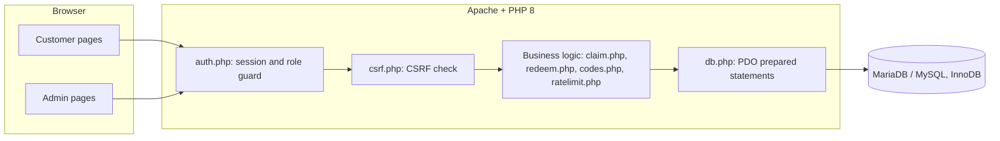
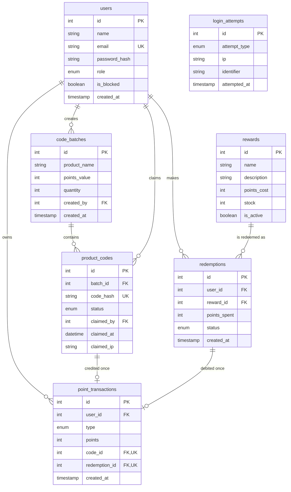
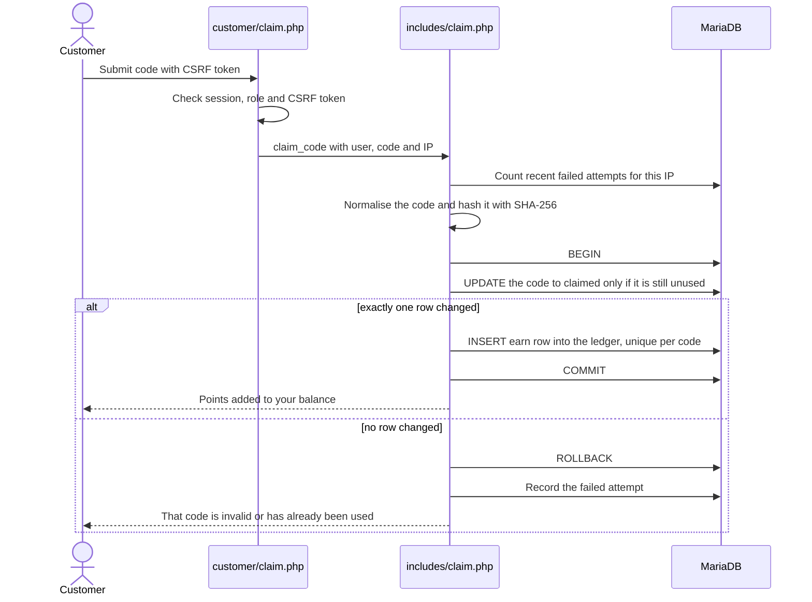
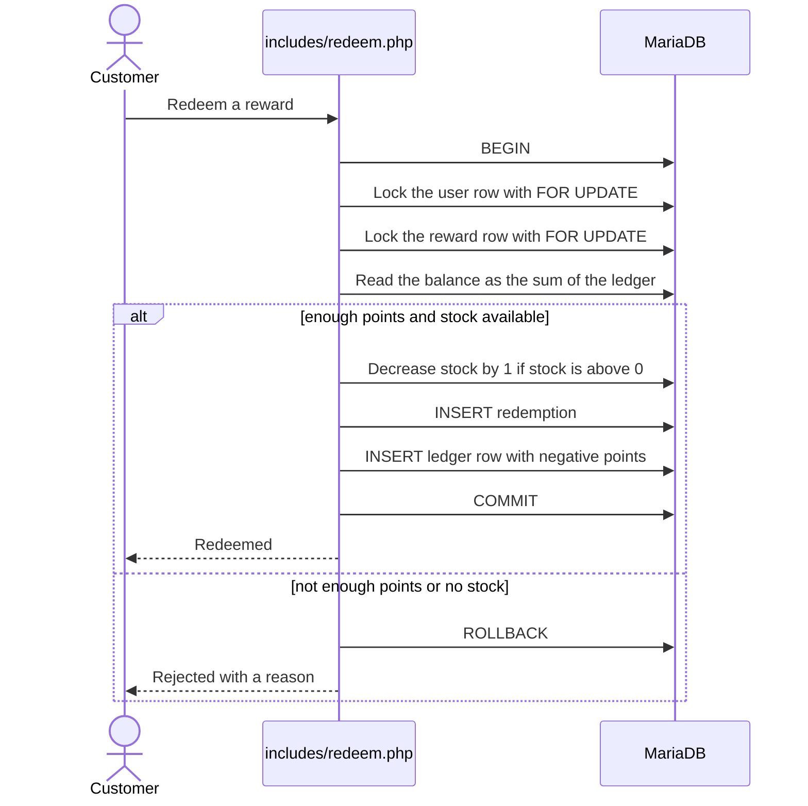

# Architecture

## 1. Overview

LoyalBox is a server-rendered web application. The browser sends requests to PHP pages running on Apache. Every page passes the same security layer (session, role check, CSRF check) and talks to one MySQL/MariaDB database through PDO. All business rules that matter for fraud (one-time claim, no double credit, no double spend) are enforced **in the database layer**, not only in PHP.

## 2. Stack choice and reasons

| Choice | Reason |
|---|---|
| **PHP 8 (no framework)** | Already known to the developer, so every part can be explained in a live demo. Runs natively in XAMPP on a Mac. Fewer moving parts than a separate API and front end. |
| **MySQL / MariaDB (InnoDB)** | Gives transactions, `UNIQUE` and `CHECK` constraints, foreign keys and row locks (`SELECT ... FOR UPDATE`). These are exactly the tools needed to make a code claimable only once. |
| **PDO with real prepared statements** | Protects against SQL injection; exceptions make failures explicit. |
| **Bootstrap 5 (CDN) and a little JavaScript** | A clean, responsive interface without a build step. |
| **Plain `.env` loader** | No Composer dependency; secrets stay out of the repository. |
| **XAMPP, Git, GitHub** | Free, standard, and easy to reproduce. |

**Why not React and Node.js?** It would mean learning a new stack, building a separate API and front end, and handling authentication, CORS and state in two places. That is too much for a two-day deadline and adds nothing to the three design questions the project is judged on. The trade-off is that PHP is less fashionable, but the security and design decisions are the same in either stack.

## 3. System architecture

**Layers**

| Layer | Files | Responsibility |
|---|---|---|
| Pages | `login.php`, `register.php`, `customer/*`, `admin/*` | Read the request, call the logic, render HTML (all output escaped with `e()`) |
| Security | `includes/auth.php`, `csrf.php`, `ratelimit.php` | Session start, role guards (`require_role`), CSRF check on every POST, rate limiting |
| Business logic | `includes/claim.php`, `redeem.php`, `codes.php` | Code generation and hashing, the claim transaction, the redemption transaction |
| Data access | `includes/db.php`, `config.php` | One PDO connection configured from `.env` |
| Database | `database/schema.sql` | Constraints that hold even if application code has a bug |

## 4. Data model

**Tables**

| Table | Purpose |
|---|---|
| `users` | Customers and the admin. `role` separates them, `is_blocked` disables an account. Email is unique. |
| `code_batches` | One generation run: product name, points per code, quantity, who created it. |
| `product_codes` | One row per box code. Stores only `code_hash` (SHA-256, unique), the status (`unused`, `claimed`, `void`), and who claimed it, when and from which IP. |
| `rewards` | Items the customer can redeem, with point cost, stock and an active flag. |
| `redemptions` | One row per redemption, with the points actually spent and a status (`pending`, `fulfilled`, `cancelled`). |
| `point_transactions` | The points ledger. Earn rows are positive, redeem rows negative. The balance is the sum of a user's rows. |
| `login_attempts` | Failed logins and failed claims, used for rate limiting and for the monitor page. |

**Constraints that carry the security**

| Constraint | What it guarantees |
|---|---|
| `product_codes.code_hash UNIQUE` | No two boxes can share a code |
| `point_transactions.code_id UNIQUE` | A code can be credited at most once, even if the application code had a bug |
| `point_transactions.redemption_id UNIQUE` | A redemption can be debited at most once |
| `CHECK` on `point_transactions` | Earn rows are positive and redeem rows negative |
| `CHECK` on batches and rewards | Points and costs are positive |
| Foreign keys everywhere | No orphan rows; history cannot refer to missing users, codes or rewards |
| `users.email UNIQUE` | One account per email; the registration page maps the error to a friendly message |

## 5. Key flows

### 5.1 Claiming a code (one-time use)

The central statement is a single `UPDATE product_codes SET status='claimed', ... WHERE code_hash=? AND status='unused'`, followed by a check that exactly one row changed. A "check, then update" pattern in two steps would be a race condition, because two requests could both see `unused`. With one conditional update only one request can change the row; the other updates zero rows and is rejected. The unique `code_id` in the ledger is a second safety net.

### 5.2 Redeeming a reward (no double spending)

The balance is read only after the user row is locked, so two simultaneous redemptions queue up: the second one sees the already reduced balance. Locks are always taken in the same order (user, then reward) to avoid deadlocks. Claims do not lock the user row, because a claim can only add points and so can never cause an overdraw.

### 5.3 Authentication

1. Registration always creates a `customer`; the admin is created only from the command line.
2. At login the password is checked with `password_verify()`. Wrong email and wrong password give the same message and similar timing, and failures count against the IP.
3. A successful login regenerates the session ID (prevents session fixation).
4. On every request the user is re-read from the database, so blocking a user takes effect immediately.
5. Logout is a POST with a CSRF token, so another site cannot log a user out.

## 6. Security design

| Threat | Control | Where |
|---|---|---|
| Guessing or enumerating codes | 130-bit random codes, rate limit of 5 failed claims per 15 minutes per IP | `codes.php`, `ratelimit.php` |
| Stolen database | Only SHA-256 hashes of codes; bcrypt hashes of passwords | `product_codes`, `users` |
| Same code claimed twice, or two requests at once | Atomic conditional update plus `UNIQUE(code_id)` | `claim.php`, `schema.sql` |
| Spending more points than owned | Row locks, balance read inside the transaction, ledger `CHECK` | `redeem.php` |
| Reward stock going negative | `UPDATE ... WHERE stock > 0` and a row lock | `redeem.php` |
| SQL injection | Prepared statements only | all queries |
| Cross-site scripting | Output escaped with `htmlspecialchars` | `e()` in `helpers.php` |
| Cross-site request forgery | Per-session CSRF token checked with `hash_equals` on every POST | `csrf.php` |
| Session theft or fixation | `HttpOnly`, `SameSite=Lax`, `Secure` over HTTPS, ID regenerated at login | `auth.php` |
| Privilege escalation | Role check on every page; role hard-coded at registration; admin only via CLI | `require_role()`, `register.php` |
| Brute-force login | 5 failed logins per 15 minutes per IP | `login.php`, `ratelimit.php` |
| Account and code enumeration | Same error message for different failure causes | `login.php`, `claim.php` |
| Spreadsheet formula injection | Product names starting with `=`, `+`, `-` or `@` are prefixed with `'` in the CSV | `admin/generate.php` |
| Secrets in the repository | `.env` ignored by Git; `.env.example` holds placeholders; `.htaccess` blocks `.env` and `.sql` | repository root |

## 7. Trade-offs and limitations

- **Server-rendered pages instead of an API plus single-page app.** Simpler and easier to explain; less suited to a future mobile app.
- **Hashing with SHA-256 instead of a slow password hash.** Appropriate because the codes are long and random; a slow hash would only make every claim slower.
- **Per-IP rate limiting.** Easy to implement, but users sharing one IP share a counter.
- **Ledger instead of a balance column.** A balance query sums rows, which is fine at this scale and removes any chance of drift.
- **A stolen or photographed code** that is claimed first cannot be detected by software alone. The hidden printing and the monitor page's unusual-activity alerts reduce the risk.
- **Not implemented:** email verification, password reset, refunds and cancellations, an admin audit log, QR scanning.
